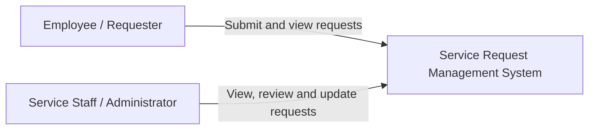
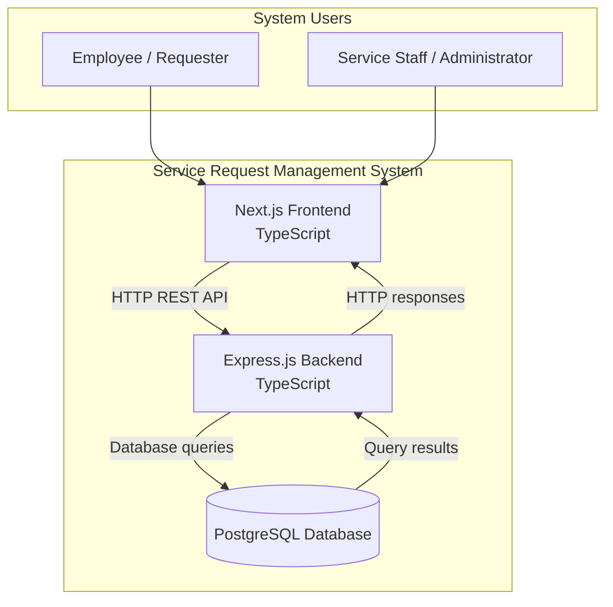
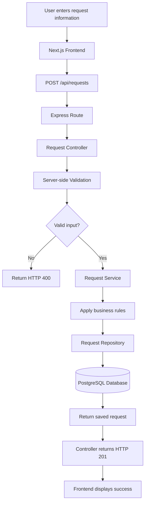

# System Architecture - Service Request Management System

## 1. Overview

The Service Request Management System uses a Modular Monolith architecture.

The application consists of a Next.js frontend, an Express.js backend, and a PostgreSQL database. The backend uses PostgreSQL for persistent data storage. The frontend and backend are designed to communicate through HTTP REST APIs; frontend-backend integration remains pending.

The backend will be organized into clear layers to maintain separation of concerns and make the application easier to maintain and test.

## 2. Architecture Style

**Selected Architecture:** Modular Monolith

The system is structured as a single backend application with logically separated modules and responsibilities.

The architecture follows these principles:

- Separation of concerns
- High cohesion
- Low coupling
- Clear module boundaries
- Dependency direction towards business logic
- Centralized data persistence

Microservices are not selected because the current project scope does not require independently deployed services.

## 3. System Context Diagram

The following diagram illustrates the Service Request Management System and its external users.

The PostgreSQL database is an internal component of the system and is therefore shown in the Container Architecture Diagram.

## 4. Container Architecture Diagram

The system consists of three main technical containers.

### 4.1 Frontend Container

**Technology:** Next.js and TypeScript

Responsibilities:

- Display the application interface.
- Allow users to create service requests.
- Display available service requests.
- Support filtering requests by status.
- Display individual request details.
- Provide request status information.
- Handle loading, empty and error states.
- Communicate with the backend through HTTP APIs.
- Support desktop and mobile screen sizes.

The frontend must not access the PostgreSQL database directly or contain authoritative business rules.

### 4.2 Backend Container

**Technology:** Express.js and TypeScript

Responsibilities:

- Expose REST API endpoints.
- Receive and validate HTTP requests.
- Apply business rules.
- Coordinate request processing.
- Manage database operations through repositories.
- Handle errors consistently.
- Provide the application health endpoint.

The backend follows a layered structure:

| Layer | Responsibility |
|---|---|
| Routes | Define API endpoints and connect them to controllers. |
| Controllers | Handle HTTP requests and responses. |
| Services | Implement business rules and coordinate operations. |
| Repositories | Define data access contracts and handle database queries and persistence. |
| Types | Define TypeScript types for service request data. |
| Validators | Validate incoming request data using defined schemas. |
| Middleware | Handle cross-cutting concerns such as request validation and error handling. |
| Configuration | Manage environment variables and PostgreSQL connection settings. |

### 4.3 Database Container

**Technology:** PostgreSQL

Responsibilities:

- Persist service request information.
- Maintain primary keys and relationships.
- Enforce applicable database constraints.
- Maintain data integrity.
- Support request retrieval and filtering.

Database credentials and connection configuration must remain on the backend and must not be exposed to the frontend.

## 5. Request Processing Flow

### 5.1 Create Service Request Flow

The following flow illustrates how a user creates a service request.

Processing responsibilities:

1. The user enters a title, description, category and priority.
2. The frontend sends the information to the backend.
3. The route directs the request to the appropriate controller.
4. The controller handles the HTTP request and invokes validation.
5. The service applies the relevant business rules.
6. The repository handles database persistence.
7. PostgreSQL stores the request.
8. The controller returns the appropriate HTTP response.
9. The frontend displays the result.

New requests must receive the initial `OPEN` status according to the requirements.

### 5.2 Status Update Flow

Status updates will be handled by the backend service layer.

The service must verify whether a requested status change follows the agreed business workflow before allowing the update.

Invalid status transitions must be rejected.

The exact permitted status transition rules require supervisor confirmation before implementation.

## 6. API Communication

The backend exposes HTTP REST APIs for communication with the frontend. Frontend-backend integration remains pending.

The following backend API operations are currently implemented:

- Create service requests.
- Retrieve all service requests.
- Filter service requests by status.
- Retrieve an individual service request.
- Check backend health.

The following operation is planned but has not yet been implemented:

- Update a service request status. The endpoint and permitted status transitions require supervisor confirmation.

The detailed endpoints, request payloads and response structures are documented in `docs/api-contract.md`.

## 7. Architecture Trade-off

### Selected Approach: Modular Monolith

**Advantages:**

- Simpler development and deployment.
- Clear separation of responsibilities.
- Easier debugging and testing for the current project scope.
- Less infrastructure and operational complexity.
- Supports future modular improvements.

**Trade-off:**

All backend modules are deployed as one application. Individual modules cannot be independently deployed or scaled.

This is acceptable for the current training project because the system has a limited scope and does not require independently deployable services.

## 8. Known Risks

| Risk | Description | Consideration |
|---|---|---|
| Authentication scope | Authentication and authorization requirements are not finalized. | Confirm the expected scope with the supervisor. |
| Status workflow | Exact permitted status transitions are not defined. | Obtain supervisor confirmation before implementing status updates. |
| Data integrity | Invalid or inconsistent data could affect stored requests. | Apply server-side validation and appropriate database constraints. |
| Error handling | Different modules could return inconsistent errors. | Use centralized error-handling conventions. |
| Module coupling | Poor separation could make the backend difficult to maintain. | Keep responsibilities within their appropriate layers. |

## 9. Open Questions

The following decisions require confirmation:

- Is authentication required within the MVP?
- How should requester and service staff permissions be enforced?
- What are the exact permitted request status transitions?
- Are there any additional business rules for closing or resolving requests?

These questions must be clarified before implementing the affected functionality.

## 10. Architecture Summary

The Service Request Management System will use a Modular Monolith architecture with Next.js, Express.js, TypeScript and PostgreSQL.

The frontend will manage the user interface, the backend will enforce business rules and process requests, and PostgreSQL will provide persistent data storage.

The layered backend structure will promote separation of concerns, maintainability and testability.

This architecture is appropriate for the current MVP scope and provides a foundation for future improvements.
