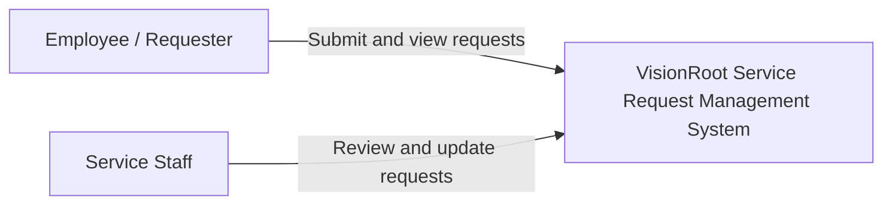
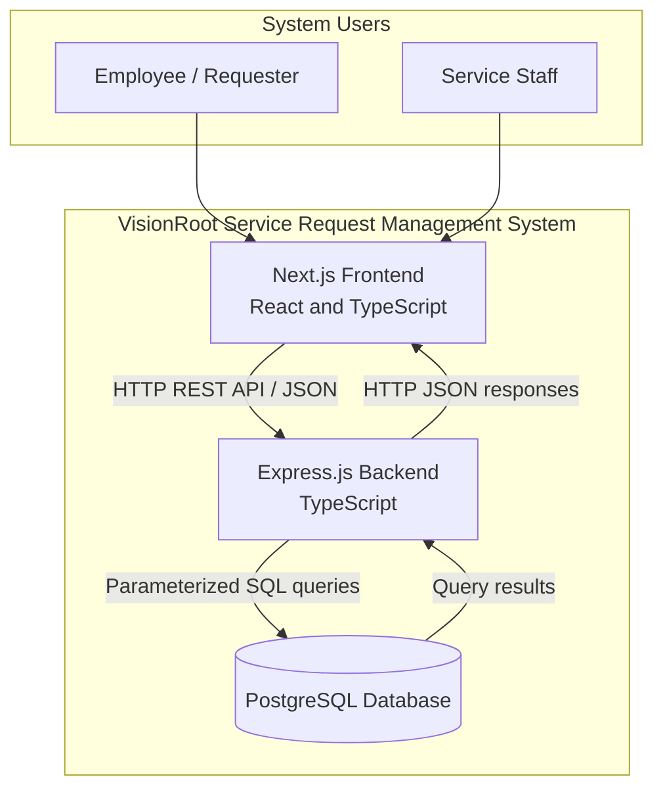
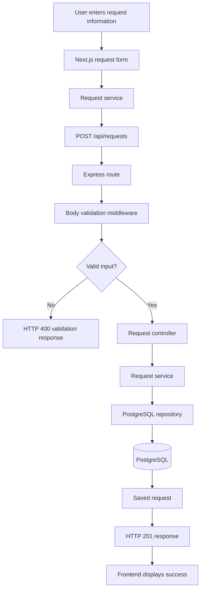

# System Architecture - Service Request Management System

## 1. Overview

The VisionRoot Service Request Management System is implemented as a modular monolith with a layered Express.js backend, a Next.js frontend and a PostgreSQL database.

The frontend communicates with the backend through HTTP REST APIs. The backend validates incoming requests, coordinates application operations through the service layer and accesses persistent data through repositories.

The current implementation supports service request creation, listing, status filtering, request details retrieval and status updates.

Authentication, authorization and business-level status-transition rules remain subject to supervisor confirmation.

## 2. Architecture Style

**Selected Architecture:** Modular Monolith

The backend is deployed as one application and organised into modules with separate responsibilities.

The architecture follows these principles:

- Separation of concerns
- High cohesion and controlled coupling
- Clear module boundaries
- Business logic separated from HTTP handling
- Database access separated through repositories
- Server-side validation
- Centralised error handling

Microservices were not selected because the current training project does not require independently deployed services. A modular monolith provides sufficient separation without introducing unnecessary infrastructure and operational complexity.

## 3. System Context Diagram

The diagram represents the intended user roles. Authentication and role-based authorization have not been confirmed as implemented features.

## 4. Container Architecture Diagram

## 5. Container Responsibilities

### 5.1 Frontend

**Technology:** Next.js, React, TypeScript and Tailwind CSS.

The frontend is responsible for:

- Displaying the dashboard and service request interface.
- Providing the request creation form.
- Displaying service requests and filtering them by status.
- Displaying individual request details.
- Providing status update controls.
- Managing loading, error, retry and success feedback.
- Communicating with the backend through the request service.
- Supporting desktop and mobile layouts.

The frontend does not access PostgreSQL directly. It must not be treated as the authority for server-side validation, access control or business rules.

### 5.2 Backend

**Technology:** Express.js and TypeScript.

The backend is responsible for:

- Exposing REST API endpoints.
- Validating incoming request data and route parameters.
- Handling HTTP requests and responses.
- Coordinating application operations through services.
- Managing persistence through repository implementations.
- Returning consistent error responses.
- Providing the API health endpoint.

The backend uses the following layers:

| Layer | Responsibility |
|---|---|
| Routes | Define API paths, HTTP methods and middleware/controller connections. |
| Controllers | Handle HTTP requests, invoke application operations and return responses. |
| Services | Coordinate request operations and implement current application rules. |
| Repositories | Define data access operations and execute database queries. |
| Validators | Validate request bodies, identifiers and supported status values. |
| Middleware | Handle request validation and centralised error responses. |
| Types | Define TypeScript data structures and interfaces. |
| Configuration | Load environment variables and configure database connections. |

### 5.3 Database

**Technology:** PostgreSQL.

The database is responsible for:

- Persisting service request records.
- Maintaining identifiers and data relationships.
- Enforcing applicable schema constraints.
- Supporting request retrieval and status filtering.

Database credentials and connection settings are maintained on the backend and are not exposed to the frontend.

## 6. Implemented Request Processing Flow

### 6.1 Create Service Request

Processing responsibilities:

1. The user enters a title, description, category and priority.
2. The frontend request service sends the information to the backend.
3. The Express route applies request-body validation.
4. The controller handles the HTTP operation.
5. The service coordinates request creation.
6. The repository persists the request in PostgreSQL.
7. The backend returns the created request with HTTP 201.
8. The frontend displays the result and updates its visible state.

The backend assigns the initial `OPEN` status and server-managed identifier and timestamps.

### 6.2 Retrieve and Filter Requests

1. The frontend calls `GET /api/requests`.
2. The backend validates an optional status filter.
3. The controller invokes the request service.
4. The repository retrieves matching records from PostgreSQL.
5. The backend returns the records in a JSON response.
6. The frontend displays the requests.

An unsupported status filter returns HTTP 400. An empty result set is represented by a successful response containing an empty data array.

### 6.3 Retrieve Request Details

1. The frontend opens the request details page using its identifier.
2. The request service sends `GET /api/requests/:id`.
3. The backend validates the UUID format.
4. The controller requests the record through the service and repository.
5. The backend returns the record or an appropriate error response.
6. The frontend displays the details or an error and retry state.

An invalid UUID returns HTTP 400. A valid UUID that does not identify an existing record returns HTTP 404.

### 6.4 Update Request Status

The implemented endpoint is:

`PATCH /api/requests/:id/status`

The backend validates the request UUID and supported status value before processing the update. The service and repository update the record and return the updated request.

The supported status values are:

- `OPEN`
- `IN_PROGRESS`
- `RESOLVED`
- `CLOSED`

The endpoint supports status updates, but the permitted business-level transitions between these statuses have not been approved by the supervisor. The current implementation must not be described as enforcing a confirmed transition workflow.

## 7. API Communication

The frontend and backend communicate through HTTP REST APIs using JSON.

Implemented endpoints:

| Method | Endpoint | Purpose |
|---|---|---|
| GET | `/` | API root response |
| GET | `/api/health` | Basic API process health |
| POST | `/api/requests` | Create a service request |
| GET | `/api/requests` | Retrieve service requests |
| GET | `/api/requests?status=OPEN` | Filter requests by status |
| GET | `/api/requests/:id` | Retrieve request details |
| PATCH | `/api/requests/:id/status` | Update request status |

The detailed request and response formats are documented in `docs/api-contract.md`.

## 8. Error Handling and Validation

The backend uses Zod schemas to validate request bodies, UUID parameters and supported status values.

Validation failures return HTTP 400 with a structured JSON error response. Unknown routes return HTTP 404. Unexpected application errors are handled by centralised error middleware and return a generic HTTP 500 response.

Malformed JSON request bodies are handled as HTTP 400 errors.

The API does not intentionally expose database credentials or internal stack traces in client-facing error responses.

## 9. Database and Runtime Configuration

The backend uses the PostgreSQL connection pool configured through environment variables.

The database configuration includes:

- A maximum connection pool size.
- An idle connection timeout.
- A connection establishment timeout.
- An error listener for unexpected pool errors.

The backend checks database connectivity during startup before accepting requests.

The current `/api/health` endpoint confirms that the API process responds. It does not independently check PostgreSQL availability for each health request.

The database schema is maintained in `backend/database/schema.sql`. A dedicated migration framework has not been identified in the reviewed project structure.

## 10. Architecture Trade-offs

### Selected Approach: Modular Monolith

Advantages:

- Simpler development and deployment.
- Clear separation of responsibilities.
- Easier debugging and testing for the current scope.
- Less infrastructure and operational complexity.
- Supports incremental improvements.

Trade-offs:

- Backend modules are deployed as one application.
- Individual modules cannot be independently deployed or scaled.
- Module boundaries must be maintained through code review and development practices.

This approach is suitable for the current training MVP because independently deployable services are not required.

## 11. Known Risks and Limitations

| Area | Current limitation | Required follow-up |
|---|---|---|
| Authentication | No verified completed authentication feature is established by this review. | Confirm scope with the supervisor. |
| Authorization | Role-based permissions remain unconfirmed. | Confirm roles and server-side access rules. |
| Status workflow | Business-level transition rules are not confirmed or enforced. | Obtain the approved workflow before implementation. |
| Automated database testing | A PostgreSQL repository integration test has been implemented and passed (1/1) using a dedicated test database. | Expand integration coverage where required and retain isolated test-database safeguards. |
| Frontend automated testing | 16 automated frontend tests across two test files passed. Browser-level end-to-end coverage has not yet been established. | Add browser-level end-to-end tests for critical user workflows. |
| Secret scanning | A complete automated and historical Git secret scan has not been completed. | Perform an approved secret scan. |
| Health monitoring | The health endpoint does not independently check database readiness. | Confirm deployment monitoring requirements. |
| Database migrations | A migration framework was not identified. | Confirm schema change and migration procedures. |
| Production deployment | No public production deployment has been performed. | Obtain supervisor approval and deployment configuration. |

## 12. Architecture Summary

The current VisionRoot Service Request Management System uses a Next.js frontend, an Express.js and TypeScript backend, and PostgreSQL persistence.

The frontend communicates with the backend through REST APIs. The backend separates HTTP handling, validation, application operations and database access through routes, controllers, services, validators and repositories.

The modular monolith approach provides a practical structure for the training MVP while keeping the implementation understandable and testable.

The application has passed the documented local backend and frontend verification checks, including 34/34 backend automated tests, 1/1 PostgreSQL repository integration test using a dedicated test database, and 16/16 frontend automated tests. These results do not establish production approval or complete browser-level end-to-end coverage. Authentication, authorization, approved status-transition rules, browser-level end-to-end testing, security scanning and deployment review remain outstanding.
