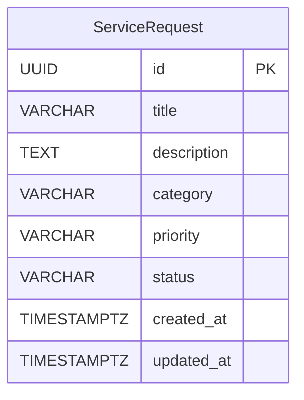

# Service Request Management System
## Day 02 - Data Model Design

## 1. Overview

This document describes the proposed database structure for the Service Request Management System.

The system will use PostgreSQL as its relational database. The initial MVP data model focuses on storing service requests and supporting the required operations.

## 2. Entity Overview

The MVP will initially use one main entity:

- ServiceRequest

Additional entities, such as User, may be introduced after authentication and authorization requirements are confirmed.

## 3. ServiceRequest Entity

The ServiceRequest entity stores the information submitted when an employee creates a service request.

| Field | Data Type | Constraints | Description |
|---|---|---|---|
| id | UUID | Primary Key, NOT NULL | Unique identifier for each service request |
| title | VARCHAR(150) | NOT NULL | Short title describing the request |
| description | TEXT | NOT NULL | Detailed explanation of the reported issue |
| category | VARCHAR(30) | NOT NULL, CHECK constraint | Request category |
| priority | VARCHAR(10) | NOT NULL, CHECK constraint | Request priority |
| status | VARCHAR(20) | NOT NULL, DEFAULT 'OPEN', CHECK constraint | Current request status |
| created_at | TIMESTAMPTZ | NOT NULL, DEFAULT CURRENT_TIMESTAMP | Record creation timestamp |
| updated_at | TIMESTAMPTZ | NOT NULL, DEFAULT CURRENT_TIMESTAMP | Last update timestamp |

## 4. Primary Key Strategy

The ServiceRequest entity will use a UUID primary key.

Example:

`550e8400-e29b-41d4-a716-446655440000`

Reasons for selecting UUID:

- Provides a unique identifier for each request.
- Avoids relying on sequential numeric identifiers.
- Can be generated by the application before database insertion.
- Provides a consistent identifier format for API endpoints.

The application will generate the UUID when creating a new service request.

## 5. Field Validation and Constraints

### 5.1 Title

- Required field.
- Leading and trailing whitespace must be removed.
- Whitespace-only values must be rejected.
- Proposed minimum length: 3 characters.
- Proposed maximum length: 150 characters.

### 5.2 Description

- Required field.
- Leading and trailing whitespace must be removed.
- Whitespace-only values must be rejected.
- Proposed minimum length: 10 characters.
- Proposed maximum length: 5,000 characters.

### 5.3 Category

The supported category values are:

- IT
- Facilities
- Other

Only these values should be accepted.

Database CHECK constraint:

`CHECK (category IN ('IT', 'Facilities', 'Other'))`

### 5.4 Priority

The supported priority values are:

- LOW
- MEDIUM
- HIGH

Only these values should be accepted.

Database CHECK constraint:

`CHECK (priority IN ('LOW', 'MEDIUM', 'HIGH'))`

### 5.5 Status

The supported status values are:

- OPEN
- IN_PROGRESS
- RESOLVED
- CLOSED

New service requests must initially receive the OPEN status.

Status updates must follow the workflow agreed with the supervisor. Invalid status transitions must be rejected by the backend.

The exact transition rules remain pending confirmation.

Database CHECK constraint:

`CHECK (status IN ('OPEN', 'IN_PROGRESS', 'RESOLVED', 'CLOSED'))`

### 5.6 Proposed Database Length Constraints

The proposed title and description length limits can also be enforced through database CHECK constraints:

- Title: `CHECK (char_length(btrim(title)) BETWEEN 3 AND 150)`
- Description: `CHECK (char_length(btrim(description)) BETWEEN 10 AND 5000)`

These proposed limits must be reviewed before implementation.

## 6. Timestamp Management

### created_at

- Records when the service request was created.
- Must be managed by the server or database.
- Must not be supplied or controlled by the client.

### updated_at

- Records the latest update time.
- Must be updated when a service request is modified.
- The backend update operation will set it using the database current timestamp.
- The client must not directly control this value.

Both fields will use the PostgreSQL TIMESTAMPTZ type to retain timezone-aware timestamps.

## 7. Entity Relationship Diagram

The initial MVP contains one main entity.

No foreign-key relationships are defined in the initial model.

A relationship with a User entity may be introduced after the authentication and requester-identification requirements are confirmed.

## 8. Data Integrity Rules

The database and backend must work together to protect data integrity.

- Every service request must have a unique UUID.
- Title and description cannot be NULL.
- Category must contain a supported value.
- Priority must contain a supported value.
- Status must contain a supported value.
- New requests must start with OPEN status.
- Creation and update timestamps must be maintained.
- Invalid status transitions must be rejected by backend business logic.

## 9. Design Decisions

| Decision | Selected Approach | Reason |
|---|---|---|
| Database | PostgreSQL | Required project database |
| Primary Key | UUID | Consistent unique identifiers |
| Category | Constrained string values | Supports the defined MVP categories |
| Priority | Constrained string values | Supports the defined priority levels |
| Status | Constrained string values | Supports the defined request statuses |
| Timestamps | TIMESTAMPTZ | Supports timezone-aware date and time storage |

## 10. Assumptions and Pending Confirmations

The following items require review or confirmation:

1. Proposed title and description length limits.
2. Whether authentication is included in the MVP.
3. Whether a User entity and requester relationship are required.
4. Whether request status history must be stored.
5. The exact allowed status transition workflow.
6. Whether additional request categories or priority levels are required.

These items must be reviewed before implementing functionality that depends on them.

## 11. Summary

The proposed MVP data model uses PostgreSQL and a ServiceRequest entity with a UUID primary key.

It defines the required request information, supported category, priority and status values, timestamps and data integrity constraints.

The model provides a foundation for implementing the service request management features while keeping unresolved requirements clearly documented.
